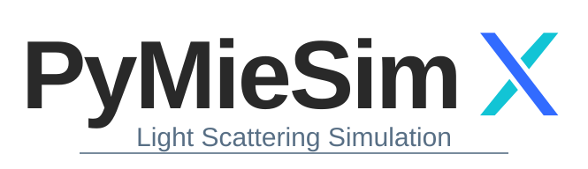
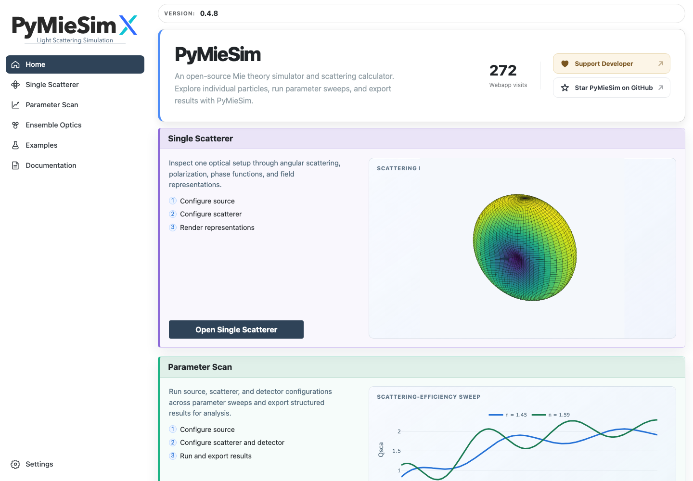

PyMieSimX
=========

.. list-table::
   :width: 100%
   :widths: 35 65
   :header-rows: 1

   * - Badge
     - Status
   * - Web app
     - |mps-demo|
   * - Python versions
     - |mps-python|
   * - Documentation
     - |mps-docs|
   * - Continuous integration
     - |mps-ci|
   * - Test coverage
     - |mps-coverage|
   * - PyPI package
     - |mps-pypi|
   * - PyPI downloads
     - |mps-downloads|
   * - Anaconda package
     - |mps-conda|
   * - Anaconda downloads
     - |mps-conda-downloads|
   * - Latest Anaconda release
     - |mps-conda-release|

Interactive Mie scattering simulations for individual particles, parameter sweeps, and dilute particle populations.

Explore how particle size, composition, and illumination change scattering with
`PyMieSim <https://github.com/MartinPdeS/PyMieSim>`_. Open a setup from the
**Examples** page, adjust its inputs, and select **Run**.

* **Single Scatterer** shows the angular scattering, polarization, and fields of one particle.
* **Parameter Scan** sweeps source, scatterer, or detector parameters and compares the resulting measures.
* **Ensemble Optics** averages optical properties over a dilute population of spheres with a chosen size distribution and concentration.

Export results as CSV or use **Copy simulation link** to share the setup.
Opening a shared link reruns it with the receiving installation's solver and material data.

To run locally after installation, launch ``pymiesimx``. The first launch downloads
PyOptik's refractive-index catalogue.

   PyMieSimX home page with the Single Scatterer and Parameter Scan workspaces.

Installation
------------

Requires Python ``>=3.11``.

.. code-block:: console

   $ python -m pip install PyMieSimX

Install from the ``martinpdes`` Conda channel:

.. code-block:: console

   $ conda install -c martinpdes pymiesimx

For an editable source installation:

.. code-block:: console

   $ git clone https://github.com/MartinPdeS/PyMieSimX.git
   $ cd PyMieSimX
   $ python -m pip install -e .

Calculate scattering efficiency in Python
-----------------------------------------

Compute the scattering efficiency of a 500 nm sphere at a wavelength of 650 nm.
With these inputs, the dimensionless scattering efficiency is approximately 1.629.

.. code-block:: python

   """Calculate the scattering efficiency of a single sphere."""

   from PyMieSimX import run_experiment

   result = run_experiment(
       source_type="GaussianSet",
       source_values={
           "wavelength": "650",
           "polarization": "0",
           "optical_power": "1e-3",
           "numerical_aperture": "0.2",
       },
       scatterer_type="SphereSet",
       scatterer_values={"diameter": "500", "material": "1.4", "medium": "1.0"},
       detector_type="None",
       detector_values={},
       measure="Qsca",
   )
   print(result["rows"][0]["Qsca"])

Documentation
-------------

Read the `PyMieSimX documentation <https://martinpdes.github.io/PyMieSimX/>`__.

Contributing
------------

See the `contributing guide <https://github.com/MartinPdeS/PyMieSimX/blob/HEAD/CONTRIBUTING.md>`__.

Contact
-------

* `Martin Poinsinet de Sivry-Houle <mailto:martin.poinsinet.de.sivry@gmail.com?subject=PyMieSimX>`__

License
-------

PyMieSimX is distributed under ``MIT``.

See the `license text <https://github.com/MartinPdeS/PyMieSimX/blob/HEAD/LICENSE>`__.

.. |mps-python| image:: https://img.shields.io/pypi/pyversions/pymiesimx.svg
   :alt: Supported Python versions
   :target: https://pypi.org/project/pymiesimx/

.. |mps-pypi| image:: https://img.shields.io/pypi/v/pymiesimx.svg
   :alt: PyPI version
   :target: https://pypi.org/project/pymiesimx/

.. |mps-downloads| image:: https://img.shields.io/pypi/dm/pymiesimx.svg
   :alt: Monthly PyPI downloads
   :target: https://pypistats.org/packages/pymiesimx

.. |mps-demo| image:: https://img.shields.io/badge/Launch-PyMieSimX-2672d6.svg
   :alt: Launch PyMieSimX
   :target: https://pymiesim.onrender.com/

.. |mps-docs| image:: https://github.com/MartinPdeS/PyMieSimX/actions/workflows/deploy_documentation.yml/badge.svg
   :alt: Documentation
   :target: https://martinpdes.github.io/PyMieSimX/

.. |mps-ci| image:: https://github.com/MartinPdeS/PyMieSimX/actions/workflows/deploy_coverage.yml/badge.svg
   :alt: Continuous integration
   :target: https://github.com/MartinPdeS/PyMieSimX/actions/workflows/deploy_coverage.yml

.. |mps-conda| image:: https://anaconda.org/martinpdes/pymiesimx/badges/version.svg
   :alt: Anaconda version
   :target: https://anaconda.org/martinpdes/pymiesimx

.. |mps-conda-downloads| image:: https://anaconda.org/martinpdes/pymiesimx/badges/downloads.svg
   :alt: Anaconda downloads
   :target: https://anaconda.org/martinpdes/pymiesimx

.. |mps-conda-release| image:: https://anaconda.org/martinpdes/pymiesimx/badges/latest_release_relative_date.svg
   :alt: Latest Anaconda release
   :target: https://anaconda.org/martinpdes/pymiesimx
