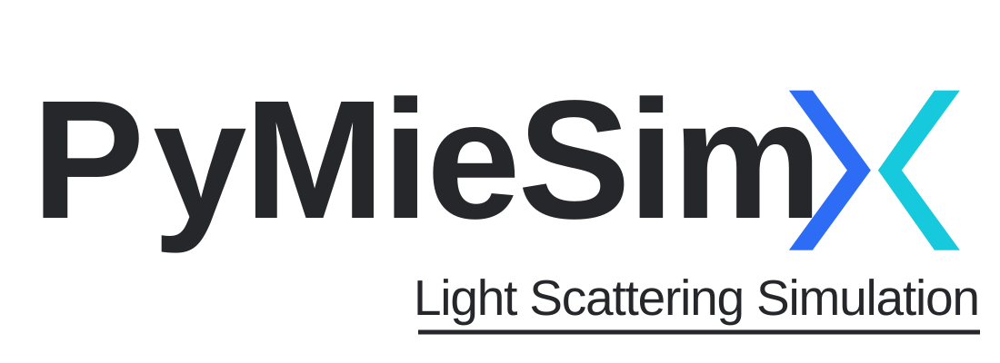

PyMieSimX
=========

PyMieSimX is a Dash interface for configuring and exploring
`PyMieSim <https://martinpdes.github.io/PyMieSim/>`_ scattering simulations.
Use the web interface for interactive work, or call the lightweight Python API
from scripts and notebooks.

.. toctree::
   :maxdepth: 2
   :caption: User guide

   getting_started
   how_it_works
   sharing

.. toctree::
   :maxdepth: 2
   :caption: Reference

   api
   gui

.. toctree::
   :maxdepth: 1
   :caption: Project

   contributing

Key features
------------

* Configure single scatterer, parameter-scan, and ensemble optics studies.
* Explore scattering, absorption, extinction, efficiencies, and angular plots.
* Share a complete simulation setup with a URL and export computed results as
  CSV files.
* Use the same calculations without starting Dash through the Python API.

The scientific solver and material catalogue are provided by PyMieSim and
PyOptik. PyMieSimX focuses on the user interface, validation, plotting, and
export workflows around them.
